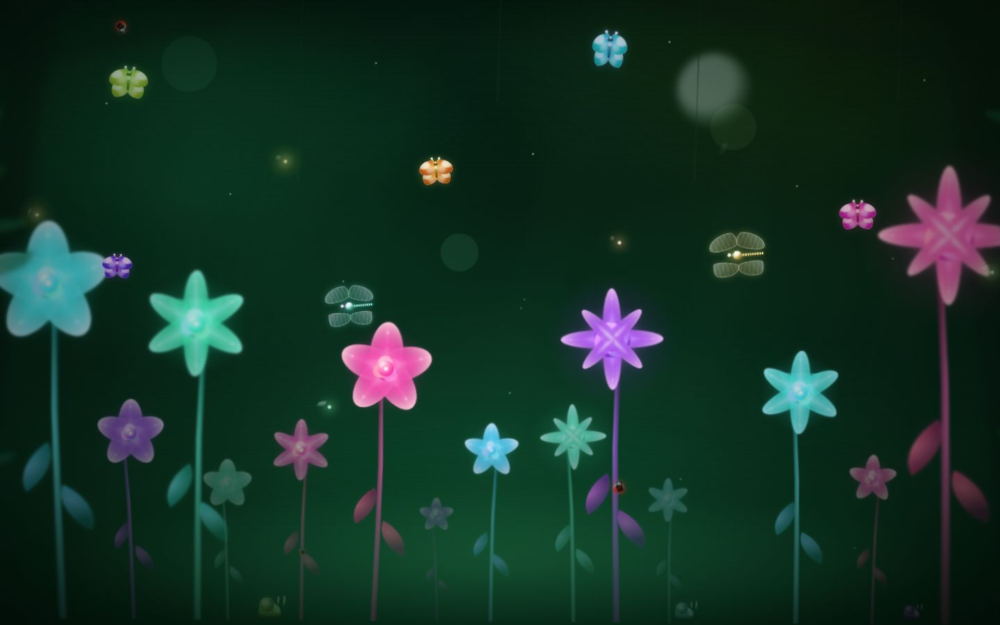
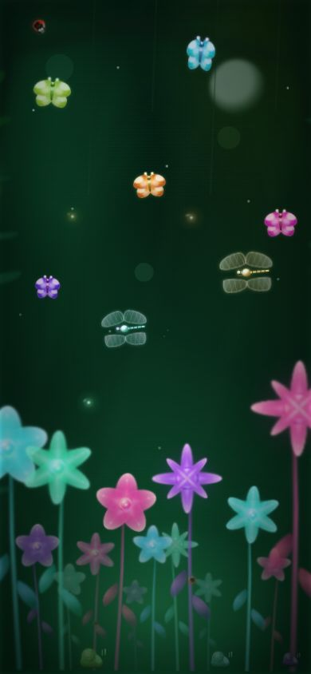

# Taman Bunga

[](https://github.com/fadhilfaith48/Taman-Bunga/actions/workflows/ci.yml)
[](LICENSE)

Taman bunga malam interaktif yang dibuat dengan HTML, CSS (SCSS), dan sedikit
JavaScript. Bunga glowing cyan, teal, pink, ungu, dan putih mekar perlahan,
dilengkapi kupu-kupu 3D, capung, kepik, siput, lapisan dedaunan, dan parallax
kamera yang mengikuti pointer — semuanya tanpa gambar, SVG eksternal, atau
library pihak ketiga.

**Live:** <https://fadhilfaith48.github.io/Taman-Bunga/>

## Pratinjau

| Desktop 1440×900 | Ponsel 390×844 |
| --- | --- |
|  |  |

## Fitur

- **Bunga sebagai subjek utama** — 14 bunga, 4 lapis kedalaman, kelopak dengan
  urat dan embun, napas & goyang berlapis.
- **Makhluk CSS** — 5 kupu-kupu (kepakan `rotateY` 3D), 2 capung bersayap
  berurat, 3 kepik, 3 siput spiral. Tanpa elemen gambar.
- **Taman berlapis** — siluet pohon, sulur, glow bulan, spora, firefly, dan
  dedaunan framing.
- **Kamera 3D** — `perspective` + `translateZ` per lapisan (`$scene-layers`)
  dengan skala kompensasi otomatis, drift halus, dan parallax mengikuti pointer
  lewat JS minimal (`js/scene.js`, opsional).
- **Aksesibilitas** — semua gerakan berhenti pada `prefers-reduced-motion`,
  elemen dekoratif `aria-hidden`, heading tersembunyi tetap ada.
- **Responsif** — tanpa scroll horizontal di 360–1920 px, ukuran memakai
  `clamp()`/`vmin`/`svh`.

## Struktur Proyek

```
Taman Bunga Prroyek/
├── index.html              # Halaman utama (dilayani GitHub Pages)
├── flower.html             # Pengalih ke index.html (link lama tetap hidup)
├── 404.html                # Halaman "tidak ditemukan" bertema taman
├── favicon.ico             # Ikon tab: bunga 16/32/48 (PNG di dalam ICO)
├── site.webmanifest        # PWA: nama, tema, ikon 192/512 (any + maskable)
├── icon-192.png            # Ikon PWA 192x192
├── icon-512.png            # Ikon PWA 512x512
├── maskable-192.png        # Ikon maskable (zona aman) 192x192
├── maskable-512.png        # Ikon maskable (zona aman) 512x512
├── assets/
│   ├── og-cover.jpg         # Gambar pratinjau tautan (og:image)
│   ├── apple-touch-icon.png # Ikon Add to Home Screen iOS
│   └── screenshots/         # Cuplikan untuk README
├── css/
│   └── style.css            # Hasil kompilasi SCSS (dipakai index.html)
├── js/
│   └── scene.js             # Parallax pointer (opsional, progresif)
├── scss/
│   ├── _variables.scss      # Data: posisi bunga, palet, makhluk, scene 3D
│   ├── _flowers.scss        # Komponen bunga + kemiringan 3D mahkota
│   ├── _creatures.scss      # Kupu-kupu, capung, kepik, siput
│   └── style.scss           # Entry point: panggung, latar, lapisan 3D
├── scripts/
│   └── check-css.js         # Cek css/style.css masih sinkron dengan scss/
├── tests/
│   ├── helpers.js           # Deteksi browser + URL tes
│   ├── qa.js                # QA 6 viewport, reduced-motion, FPS
│   └── parallax.js          # Uji kedalaman parallax per lapisan
├── .github/workflows/ci.yml # CI: cek sinkron CSS + validasi HTML + QA visual
├── .htmlvalidate.json      # Aturan gaya validasi HTML
├── CHANGELOG.md             # Riwayat rilis
├── LICENSE                  # MIT
└── package.json             # Script build/check/test + versi sass terkunci
```

## Cara Menjalankan

Buka `index.html` langsung di browser, atau jalankan static server:

```bash
npx serve .
```

Versi live bisa diakses di <https://fadhilfaith48.github.io/Taman-Bunga/>
(GitHub Pages). `flower.html` tetap ada sebagai pengalih ke `index.html`.

## Build SCSS

`css/style.css` adalah hasil kompilasi folder `scss/`. Instalasi awal + build
(perlu Node `^22.22` atau `>=24.8` — lihat `engines` di `package.json`):

```bash
npm install     # sekali saja, mengunci versi sass
npm run build   # kompilasi scss/style.scss -> css/style.css
npm run watch   # kompilasi ulang otomatis saat file SCSS disimpan
npm run check   # pastikan css/style.css sinkron dengan scss/
npm run lint:html  # validasi struktur index.html & flower.html
```

Tanpa npm pun masih bisa: `npx sass scss/style.scss css/style.css --no-source-map`.

> Setiap perubahan SCSS wajib diikuti `npm run build` lalu commit bersama
> perubahannya. GitHub Actions menjalankan `npm run check`, `npm run lint:html`,
> dan `npm test` di setiap push.

## Tes

```bash
npm test        # QA 6 viewport + reduced-motion + FPS + uji parallax
```

Tes berjalan tanpa server (langsung `file://index.html`); set `SITE_URL`
untuk menguji alamat lain, mis. `SITE_URL=http://127.0.0.1:8080/index.html npm test`.
Browser diambil dari Chrome/Chromium yang terpasang — set `CHROME_PATH`
kalau lokasinya berbeda. Detail: `tests/qa.js` dan `tests/parallax.js`.

## Kredit

Dibuat oleh [fadhilfaith48](https://github.com/fadhilfaith48).
